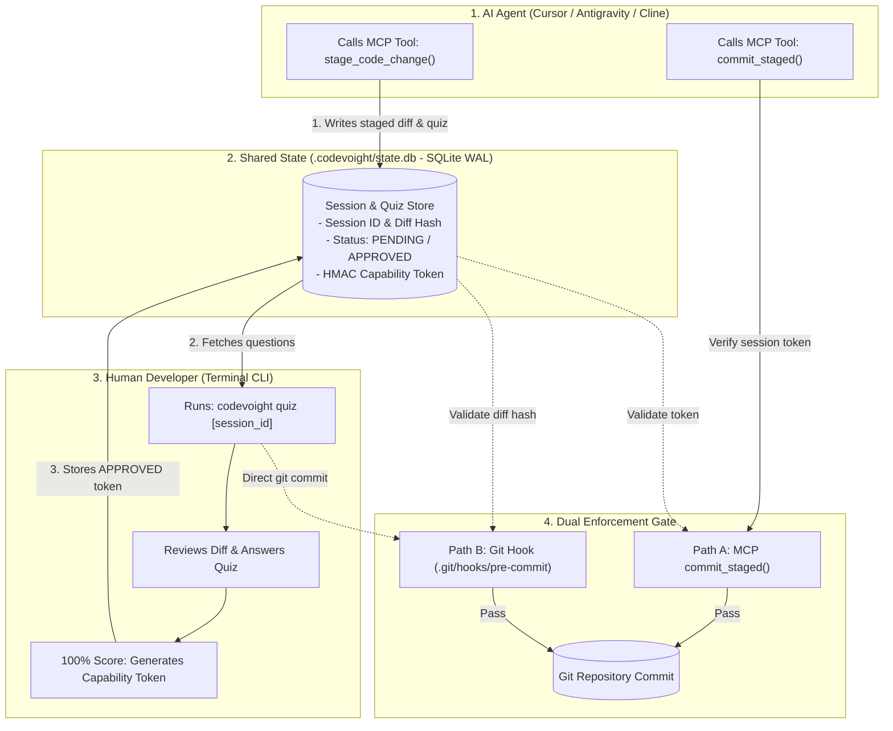

# CodeVoight

> Voight-Kampff Human Comprehension Gate for AI Coding Agents and Git Commits

**CodeVoight** (inspired by the Blade Runner Voight-Kampff interrogation test that distinguishes humans from synthetic AI) guarantees human comprehension before AI coding agents commit code. It intercepts changes into a staged verification buffer and physically blocks Git commits until the developer reviews the diff and passes an interactive comprehension quiz via the terminal.

---

## 1. Why CodeVoight?

Autonomous AI coding agents in modern IDEs (Cursor, Windsurf, Cline, Antigravity) write code directly to disk and create Git commits without verifying whether the human developer understands what changed.

CodeVoight enforces a **strict, fail-closed comprehension gate**:
1. **Agent Stages Changes**: The AI agent calls CodeVoight's MCP tool `stage_code_change`.
2. **Deterministic Quiz Generated**: CodeVoight analyzes the staged diff (AST changes, modified functions, error handling, touched files) and generates comprehension questions.
3. **Out-of-Band Human Verification**: To prevent the AI agent from answering its own quiz, the quiz must be completed by the developer via the terminal (`codevoight quiz`).
4. **Cryptographic Capability Token**: Upon passing the quiz with 100% score, an HMAC-SHA256 capability token is generated and bound to the exact SHA-256 hash of the staged diff.
5. **Physical Enforcement**: Git commits are gated both at the MCP tool level (`commit_staged`) and at the Git repository level via a `.git/hooks/pre-commit` hook. If the staged diff changes or lacks an approved token, Git aborts the commit.

---

## 2. Architecture



---

## 3. Installation & Setup

### Prerequisites
* Python 3.10+
* Git 2.20+

### Install CodeVoight
```powershell
# Clone or navigate to the repository
cd C:\Users\jbibingraceson\projects\codegate

# Create virtual environment and install in editable mode
python -m venv .venv
.\.venv\Scripts\pip.exe install -e .[dev]
```

### Install Git Pre-Commit Hook
In your project repository, install the physical commit verification hook:
```powershell
.\.venv\Scripts\codevoight.exe hook install
```
This writes `.git/hooks/pre-commit`, ensuring that any `git commit` requires a valid quiz approval token.

---

## 4. IDE MCP Configuration

### Cursor
Add to `.cursor/mcp.json` or your Cursor user settings:
```json
{
  "mcpServers": {
    "codevoight": {
      "command": "python",
      "args": ["-m", "codevoight.server"]
    }
  }
}
```

### VS Code (Cline / Roo Code)
Add to your Cline MCP settings:
```json
{
  "mcpServers": {
    "codevoight": {
      "command": "python",
      "args": ["-m", "codevoight.server"],
      "disabled": false,
      "autoApprove": []
    }
  }
}
```

### Google Antigravity
Add to your Antigravity MCP settings:
```json
{
  "mcpServers": {
    "codevoight": {
      "command": "python",
      "args": ["-m", "codevoight.server"]
    }
  }
}
```

---

## 5. CLI Commands

| Command | Description |
| :--- | :--- |
| `codevoight quiz [session_id]` | Interactive terminal quiz to review diff and unlock commit |
| `codevoight status` | View active and pending staging sessions |
| `codevoight stage <files...>` | Manually stage files and generate a comprehension quiz |
| `codevoight hook install` | Install the `.git/hooks/pre-commit` verification gate |
| `codevoight hook verify` | Test current staged Git changes against CodeVoight state |

---

## 6. Verification & Test Suite

Run the full automated test suite:
```powershell
.\.venv\Scripts\pytest.exe -v
```

The test suite covers:
* HMAC capability token generation, tampering detection, and TTL expiry.
* Cross-platform diff normalization and SHA-256 hash consistency.
* SQLite WAL concurrency and transaction rollback.
* Deterministic AST diff question generation and grading.
* End-to-end Git pre-commit hook enforcement.
* MCP stdio tool execution, blocking unapproved commits and passing approved commits.
